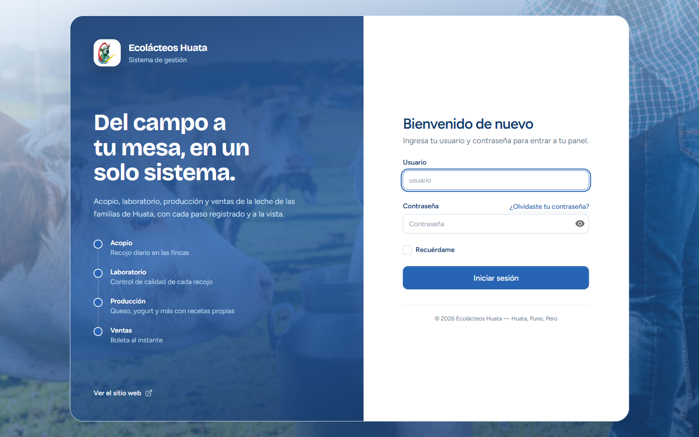
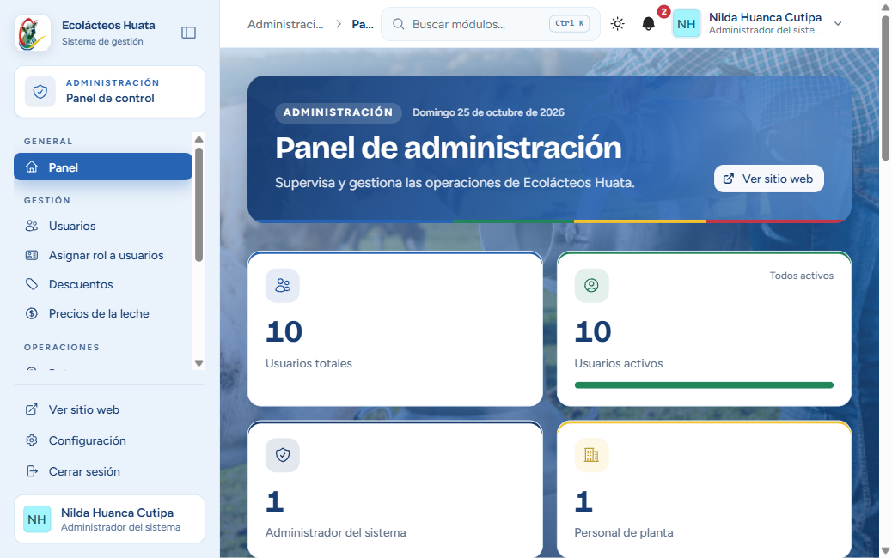
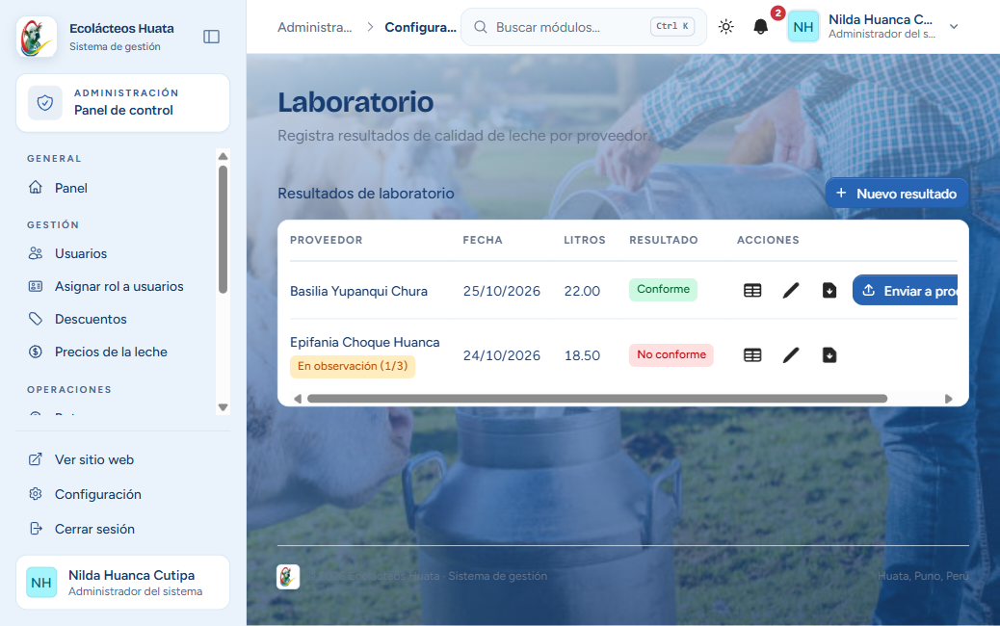
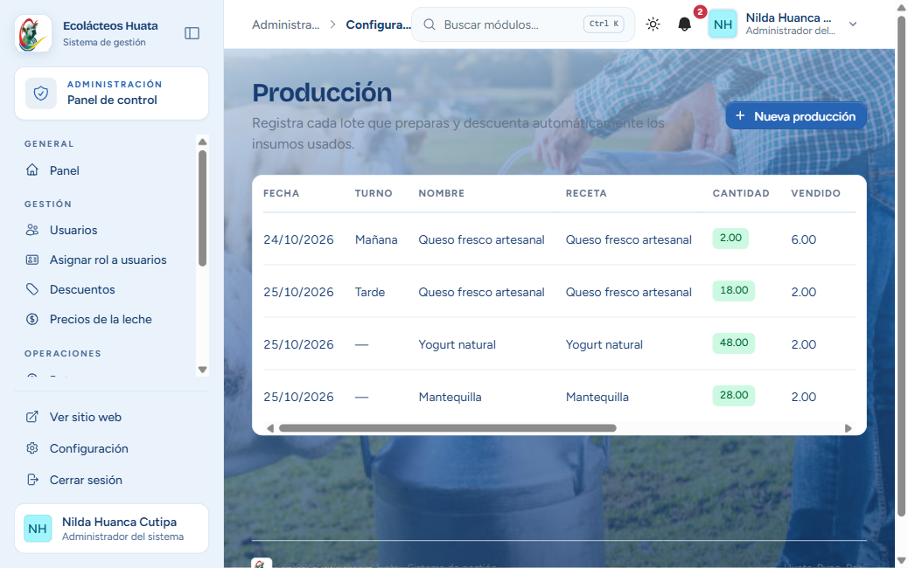
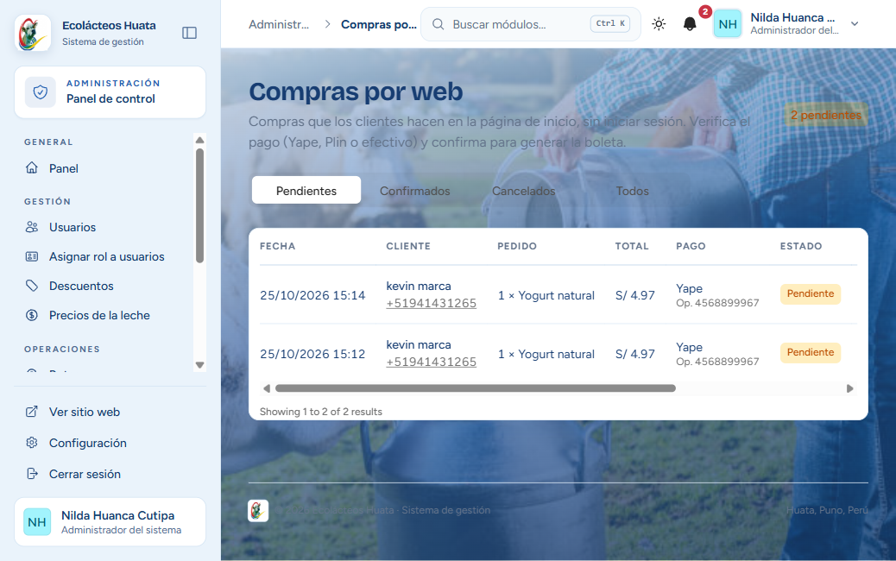
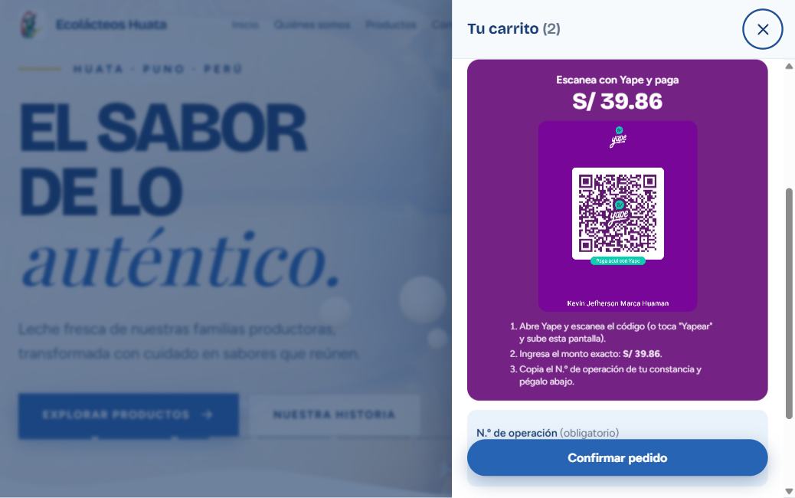

# 07 · Manual de usuario

Guía de uso por rol de Ecolácteos Huata. Las capturas son del sistema en ejecución.

## Cómo entrar

1. Abre la página del sistema y pulsa **Iniciar sesión**.
2. Escribe tu **usuario** y tu **contraseña** (te los da el administrador) y pulsa **Iniciar sesión**.
3. Entrarás directamente al panel de tu rol. Si te pide un código, es la verificación en dos pasos de tu cuenta.
4. Para salir, usa **Cerrar sesión** en la parte baja del menú lateral.

Si olvidaste tu contraseña, usa «¿Olvidaste tu contraseña?» o pide al administrador que la restablezca.

### Cómo es la pantalla

- **Menú lateral** (izquierda): módulos de tu rol; al final, «Ver sitio web», «Configuración» y «Cerrar sesión».
- **Barra superior:** buscador de módulos (`Ctrl + K`), cambio de tema claro u oscuro, campana de notificaciones y tu perfil.
- **Banner y tarjetas:** cada panel muestra un resumen con indicadores y accesos rápidos.

En celular el menú lateral se abre desde el botón de la esquina superior izquierda.

---

## Administrador

| Quiero… | Pasos |
|---|---|
| Crear un usuario | **Usuarios** → Nuevo → completa nombres, apellidos, documento, usuario, contraseña y rol → Guardar |
| Cambiar el rol de alguien | **Asignar rol a usuarios** → elige el usuario → elige el rol principal o roles extra → Guardar |
| Desactivar a un usuario | **Usuarios** → editar → desmarcar «Activo» |
| Fijar el precio de la leche | **Precios de la leche** → nuevo precio por litro y fecha de vigencia → Guardar |
| Crear un descuento | **Descuentos** → Nuevo → nombre y porcentaje → Guardar |
| Definir turnos | **Turnos** → Nuevo → nombre y horario; marca «de producción» si corresponde |
| Cambiar el teléfono de WhatsApp | **Empresa** → teléfono → Guardar (los pedidos de la tienda avisan a ese número) |
| Supervisar recojos y entregas | **Acopiador: recojo / entrega** y **Proveedor: entregas / laboratorio** |
| Dar permiso para tomar asistencia | **Asignar rol a usuarios** → elige al usuario → marca «Tomar asistencia» → Guardar |

## Acopiador

| Quiero… | Pasos |
|---|---|
| Registrar un recojo | **Recojo** → elige el proveedor de tu ruta → escribe los litros → marca el estado de la leche (Normal, Soleado, Acidificado, Aguado u Otro) → Guardar |
| Ver mi ruta en el mapa | **Mapa de recojo** |
| Entregar a la planta | **Entrega** → revisa los litros recogidos → registra la entrega con su guía |
| Imprimir mi inventario | **Inventario** → botón de PDF |
| Marcar mi asistencia | **Mis asistencias** → marcar dentro del horario |

> Si el estado de la leche no es «Normal», se cuenta como alteración del proveedor. Con 3 alteraciones el proveedor se bloquea.

## Personal de planta

| Quiero… | Pasos |
|---|---|
| Ver lo que llegó de los acopiadores | **Entregas** |
| Registrar un análisis | **Laboratorio** → Nuevo resultado → proveedor → datos del análisis → marca «Conforme» según corresponda → Guardar |
| Enviar leche conforme a producción | En **Laboratorio**, pulsa «Enviar a producción» en el resultado conforme (solo se puede una vez) |
| Descargar un resultado | **Laboratorio** → icono de PDF |
| Pagar a un proveedor | **Pagos** → elige el período → proveedor → método de pago → Registrar pago |
| Ver o editar rutas | **Rutas** |
| Publicar un aviso | **Comunicados** → Nuevo → elige los roles destinatarios |

## Proveedor

| Quiero… | Pasos |
|---|---|
| Ver cuánto entregué | **Mis entregas** |
| Ver cómo salió mi leche | **Laboratorio** |
| Leer avisos | **Comunicados** o la campana |

## Producción

| Quiero… | Pasos |
|---|---|
| Registrar unidades e insumos | **Unidades** y **Insumos** |
| Registrar una compra de insumos | **Compras** → Nueva → insumos, cantidades y precios → Guardar (aumenta el stock y recalcula el costo unitario del insumo) |
| Crear una receta | **Recetas** → Nueva → insumos y cantidades; el costo se calcula solo; puedes fijar un **precio de venta** |
| Producir | **Registros** → Nuevo → receta y cantidad → Guardar (descuenta insumos; si no alcanzan, no se guarda) |
| Publicar para la venta | En **Registros**, completa la producción para que figure como «Publicado» |
| Ver el stock | **Inventario** y **Productos** |

## Vendedor

| Quiero… | Pasos |
|---|---|
| Vender | **Ventas** → agrega productos → elige cliente (o escribe nombre y documento) → descuento → método de pago (en efectivo, el monto recibido y el vuelto) → Confirmar → descarga la boleta en PDF |
| Ver ventas anteriores | **Historial** |
| Registrar clientes | **Clientes** |
| Ver lo disponible | **Productos** e **Inventario** |
| Confirmar un pedido de la tienda | **Compras por web** → revisa el método de pago y el N.º de operación → comprueba el pago en tu app Yape o Plin → **Confirmar y facturar** |

> Confirmar un pedido crea la venta con su boleta, descuenta el stock y deja al cliente la boleta en el mismo enlace de su comprobante. Si falta stock en alguna línea, no se confirma nada.

## Asistencia (todos)

| Quiero… | Pasos |
|---|---|
| Ver mis asistencias | **Mis asistencias** |
| Justificar una falta o tardanza | **Mis asistencias** → Justificar → explica y adjunta un archivo (dentro de 7 días) |
| Tomar asistencia al personal | **Tomar asistencia** (solo con permiso) → marca presente, tardanza o falta → Guardar |

---

## Cliente de la tienda (sin cuenta)

1. Entra a la página de inicio y elige **Agregar** en los productos que quieras.
2. Abre el **carrito** (icono arriba a la derecha o la barra inferior en celular).
3. Escribe tu **nombre** (y tu celular, si quieres) y elige cómo pagar:
   - **Yape:** escanea el código QR, ingresa el monto exacto, y copia el **N.º de operación** de tu constancia en el campo indicado (es obligatorio).
   - **Plin:** paga al número que se muestra y, si quieres, anota el N.º de operación.
   - **Efectivo:** pagas al recibir o recoger tu pedido.
4. Pulsa **Confirmar pedido**.
5. Verás «¡Pedido enviado!» con el botón **Ver mi comprobante**. **Guarda ese enlace:** cuando la tienda confirme tu pago, el mismo enlace muestra tu boleta.

## Preguntas frecuentes

- **No puedo entrar.** Revisa usuario y contraseña; si sigue fallando, el administrador puede haber desactivado tu cuenta.
- **Mi proveedor aparece «bloqueado».** Acumuló 3 alteraciones de calidad; el administrador o la planta pueden desbloquearlo.
- **Mi pedido sigue «pendiente».** La tienda debe verificar tu pago y confirmarlo; mientras tanto el enlace muestra el comprobante de pedido.
- **No veo un producto en la tienda.** Solo aparecen producciones publicadas con stock disponible.
- **La página se ve en modo oscuro.** Cambia el tema con el icono del sol o la luna de la barra superior.
